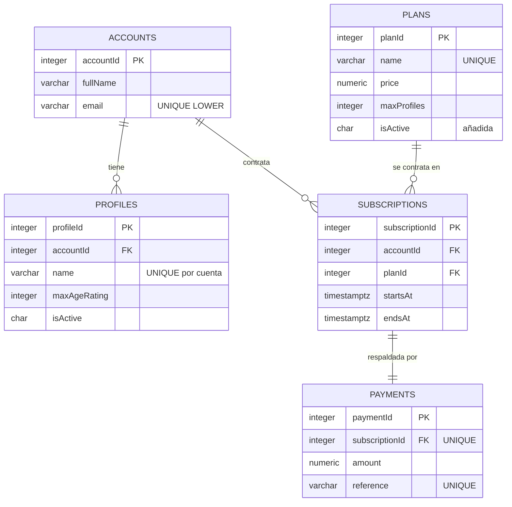

# CineConecta — Catálogo de objetos de la base de datos relacional (PostgreSQL)

> **Entregable del 10 %** (junto con la justificación de MongoDB y el modelo documental).
> Motor: **PostgreSQL 17**. Esquema: **`cineconecta`**. Scripts de creación: `db/postgres/00_roles.sql` a `03_plans.sql`.
>
> El inventario se obtuvo del catálogo del sistema (`pg_catalog` / `information_schema`) de una base creada desde cero con esos scripts, no solo de su lectura. Las consultas para regenerarlo están en el [Anexo](#anexo-cómo-regenerar-este-inventario).
>
> PostgreSQL guarda los identificadores sin comillas en minúsculas (`accountId` → `accountid`). Este documento los escribe como en el modelo suministrado, en camelCase.

---

## 1. Resumen del inventario

| Tipo de objeto | Cantidad | Objetos |
|---|---:|---|
| Esquema | 1 | `cineconecta` |
| Extensiones | 1 (+ `plpgsql`, que viene por defecto) | `btree_gist` |
| Roles (usuarios del motor) | 3 | `cine_owner`, `cine_app`, `cine_report` |
| Tablas | 5 | `accounts`, `plans`, `profiles`, `subscriptions`, `payments` |
| Vistas | 1 | `v_current_subscription` |
| Secuencias (columnas IDENTITY) | 5 | una por tabla |
| Restricciones | 22 | 5 PK · 4 FK · 3 UNIQUE · 8 CHECK · 1 EXCLUDE · 1 trigger de restricción |
| Índices | 14 | 5 de PK · 3 de UNIQUE · 2 únicos sobre expresión · 3 de consulta · 1 GiST (de la EXCLUDE) |
| Funciones | 1 | `fn_subscription_requires_payment()` |
| Triggers | 1 | `tg_subscription_requires_payment` (diferido) |

Todos los objetos del esquema pertenecen a `cine_owner`.

### Nomenclatura

| Prefijo | Objeto | Ejemplo |
|---|---|---|
| `pk_` | Clave primaria | `pk_accounts` |
| `fk_` | Clave foránea | `fk_profiles_account` |
| `uq_` | Restricción UNIQUE | `uq_payments_reference` |
| `ux_` | Índice único (sobre expresión) | `ux_accounts_email_ci` |
| `ix_` | Índice de consulta | `ix_payments_paidat` |
| `ck_` | CHECK | `ck_profiles_agerating` |
| `ex_` | Restricción EXCLUDE | `ex_subscriptions_no_overlap` |
| `fn_` / `tg_` | Función / trigger | `fn_subscription_requires_payment` |
| `v_` | Vista | `v_current_subscription` |

---

## 2. Diferencias con el modelo suministrado

Se conservan todas las tablas, columnas, longitudes, relaciones, claves e índices únicos del anexo (`pk_*`, `fk_*`, `uq_plans_name`, `uq_payments_subscription`, `uq_payments_reference`, `ux_accounts_email_ci`, `ux_profiles_name_ci`). Los cambios son los siguientes:

| # | Cambio | Tipo | Justificación |
|---|---|---|---|
| 1 | `VARCHAR2` → `VARCHAR`, `NUMBER(p,s)` → `NUMERIC(p,s)` | Traducción | El anexo está en notación Oracle; son los tipos equivalentes en PostgreSQL. Longitudes y precisiones iguales. |
| 2 | `TIMESTAMP` → `TIMESTAMPTZ` | Traducción con criterio | Guarda instantes absolutos (en UTC). La vigencia `[startsAt, endsAt)` se compara con fechas de MongoDB (UTC) en el informe de consumo; con `TIMESTAMP` sin zona, el resultado dependería de la zona horaria del servidor. |
| 3 | `INTEGER` → `INTEGER GENERATED BY DEFAULT AS IDENTITY` en las claves primarias | Mecanismo de generación | El anexo no define cómo se generan los ids. IDENTITY es el estándar SQL. `BY DEFAULT` permite cargar ids explícitos en datos de prueba. |
| 4 | **`plans.isActive CHAR(1)`** (columna nueva) | **Cambio estructural** | Requerido por la gestión de planes (RF-12.3, RI-03): un plan inactivo no se ofrece en nuevas contrataciones y las suscripciones vigentes no se afectan. Los planes nunca se borran. |
| 5 | Esquema `cineconecta` | Organización | Separa los objetos del proyecto de `public` y permite dar permisos por esquema a cada rol. |
| 6 | Restricciones `CHECK`, `EXCLUDE`, trigger, vista e índices adicionales | Permitido por el enunciado | "Se podrán incorporar restricciones, índices, vistas y procedimientos para cumplir las reglas del negocio". Cada uno se justifica en la sección 4. |

---

## 3. Esquema, extensiones y roles

### 3.1 Esquema y extensión

| Objeto | Definido en | Propósito |
|---|---|---|
| Esquema `cineconecta` | `00_roles.sql` | Contiene todos los objetos. Dueño: `cine_owner`. Se revoca `ALL` a `PUBLIC`. |
| Extensión `btree_gist` | `00_roles.sql` | Permite combinar `accountId WITH =` (entero, B-tree) con `tstzrange(...) WITH &&` (rango, GiST) en la misma restricción `EXCLUDE` (sección 4.4). |

### 3.2 Roles

Son usuarios del motor, distintos de los usuarios de la aplicación (clientes y administradores). Cada uno tiene solo los permisos que necesita.

| Rol | LOGIN | `search_path` | Uso |
|---|---|---|---|
| `cine_owner` | Sí | `cineconecta, public` | Dueño del esquema: ejecuta el DDL y las cargas. **La aplicación nunca lo usa.** |
| `cine_app` | Sí | `cineconecta, public` | Conexión de la aplicación (Spring Boot / HikariCP). |
| `cine_report` | Sí | `cineconecta, public` | Solo lectura, previsto para informes. Hoy la aplicación lee los informes con `cine_app`. |

Las contraseñas de `00_roles.sql` son de desarrollo. En la nube se cambian con `ALTER ROLE ... PASSWORD` (ver `db/README.md`).

### 3.3 Matriz de privilegios

| Objeto | `cine_app` | `cine_report` |
|---|---|---|
| Esquema `cineconecta` | `USAGE` | `USAGE` |
| `accounts` | `SELECT`, `INSERT` | `SELECT` |
| `profiles` | `SELECT`, `INSERT`, `UPDATE (name, maxAgeRating, isActive)` | `SELECT` |
| `plans` | `SELECT`, `INSERT`, `UPDATE (name, isActive)` | `SELECT` |
| `subscriptions` | `SELECT`, `INSERT` | `SELECT` |
| `payments` | `SELECT`, `INSERT` | `SELECT` |
| `v_current_subscription` | `SELECT` | `SELECT` |
| Secuencias (5) | `USAGE`, `SELECT` | — |

Los privilegios aplican las reglas de negocio directamente en el motor:

- **Nada se borra:** ningún rol de la aplicación tiene `DELETE` (cuentas, perfiles, planes, suscripciones y pagos se conservan).
- **El historial no se modifica:** `subscriptions` y `payments` solo admiten `INSERT`.
- **Precio y máximo de perfiles de un plan no cambian** (RI-03): el `UPDATE` de `plans` se limita a `name` e `isActive`.
- **La cuenta de un perfil no cambia:** el `UPDATE` de `profiles` excluye `accountId`.

Por eso las entidades JPA marcan esas columnas con `@Column(updatable = false)` o se declaran `@Immutable`.

---

## 4. Tablas

En cada tabla, la columna **Origen** indica si la columna viene del **modelo** suministrado o fue **añadida**.

### 4.1 `accounts` — cuentas de los titulares

Fuente de verdad de los clientes. Se conserva permanentemente (RI-01).

| Columna | Tipo | Nulo | Por defecto | Origen | Descripción |
|---|---|---|---|---|---|
| `accountId` | `INTEGER` IDENTITY | No | secuencia | Modelo | Identificador. Viaja en el JWT de cliente y se copia a MongoDB en `playback_sessions`. |
| `fullName` | `VARCHAR(150)` | No | | Modelo | Nombre del titular. |
| `email` | `VARCHAR(254)` | No | | Modelo | Correo de acceso. Se guarda como lo escribió el usuario; la unicidad no distingue mayúsculas. |
| `passwordHash` | `VARCHAR(255)` | No | | Modelo | Hash BCrypt. La contraseña original nunca se almacena. |
| `createdAt` | `TIMESTAMPTZ` | No | `now()` | Modelo | Fecha de registro. |

| Restricción / índice | Definición | Regla que garantiza |
|---|---|---|
| `pk_accounts` | `PRIMARY KEY (accountId)` | Identidad de la cuenta. |
| `ux_accounts_email_ci` | `UNIQUE INDEX ON (LOWER(email))` | **Correo único sin distinguir mayúsculas** (RF-01, RI-01). También atiende el login: `WHERE LOWER(email) = LOWER(?)`. Si dos registros simultáneos usan el mismo correo, rechaza el segundo. |
| `ck_accounts_email` | `CHECK (position('@' IN email) > 1)` | Barrera mínima: el correo tiene una `@` y algo antes. El formato completo lo valida la aplicación. |

### 4.2 `plans` — planes de suscripción

Gestionados por el administrador. Se desactivan, no se borran (RI-03).

| Columna | Tipo | Nulo | Por defecto | Origen | Descripción |
|---|---|---|---|---|---|
| `planId` | `INTEGER` IDENTITY | No | secuencia | Modelo | Identificador. Se copia a MongoDB como `planIdAtStart` de cada sesión de reproducción (plan vigente al iniciarla). |
| `name` | `VARCHAR(60)` | No | | Modelo | Nombre del plan. |
| `price` | `NUMERIC(12,2)` | No | | Modelo | Precio en pesos colombianos. No cambia después de crear el plan. |
| `maxProfiles` | `INTEGER` | No | | Modelo | Máximo de perfiles activos. No cambia después de crear el plan. |
| `isActive` | `CHAR(1)` | No | `'Y'` | **Añadida** | `'Y'`/`'N'`. Un plan inactivo no se ofrece para nuevas contrataciones (cambio estructural nº 4). |

| Restricción / índice | Definición | Regla que garantiza |
|---|---|---|
| `pk_plans` | `PRIMARY KEY (planId)` | Identidad del plan. |
| `uq_plans_name` | `UNIQUE (name)` | El nombre del plan no se repite. |
| `ck_plans_price` | `CHECK (price > 0)` | Precio positivo. |
| `ck_plans_maxprofiles` | `CHECK (maxProfiles BETWEEN 1 AND 10)` | Todo plan permite al menos un perfil, lo que permite inferir "sin suscripción vigente" cuando el máximo es 0. El tope de 10 evita valores absurdos. |
| `ck_plans_isactive` | `CHECK (isActive IN ('Y','N'))` | Dominio del estado. |

### 4.3 `profiles` — perfiles de visualización

Se desactivan, no se borran, para conservar su actividad histórica (RI-02).

| Columna | Tipo | Nulo | Por defecto | Origen | Descripción |
|---|---|---|---|---|---|
| `profileId` | `INTEGER` IDENTITY | No | secuencia | Modelo | Identificador. Es el `_id` de `my_lists` y aparece en `playback_sessions` (MongoDB); viaja en el JWT al elegir perfil. |
| `accountId` | `INTEGER` | No | | Modelo | Cuenta dueña. No se puede cambiar (sin `UPDATE`). |
| `name` | `VARCHAR(60)` | No | | Modelo | Nombre del perfil. |
| `maxAgeRating` | `INTEGER` | No | | Modelo | Clasificación máxima permitida (0 = todo público). |
| `isActive` | `CHAR(1)` | No | `'Y'` | Modelo | `'Y'`/`'N'`. Solo los activos se pueden elegir. |

| Restricción / índice | Definición | Regla que garantiza |
|---|---|---|
| `pk_profiles` | `PRIMARY KEY (profileId)` | Identidad del perfil. |
| `fk_profiles_account` | `FOREIGN KEY (accountId) REFERENCES accounts` | Todo perfil pertenece a una cuenta existente. |
| `ux_profiles_name_ci` | `UNIQUE INDEX ON (accountId, LOWER(name))` | **Nombre único dentro de la cuenta, sin distinguir mayúsculas** (RI-02). Como su primera columna es `accountId`, también sirve de índice para la FK y atiende "perfiles de una cuenta" y "perfiles activos de una cuenta" (el cupo del plan). |
| `ck_profiles_agerating` | `CHECK (maxAgeRating BETWEEN 0 AND 18)` | Rango de clasificación por edad (el mismo que valida el catálogo). |
| `ck_profiles_isactive` | `CHECK (isActive IN ('Y','N'))` | Dominio del estado. |

> **Regla que no se expresa como restricción:** "los perfiles activos no superan el máximo del plan vigente" depende del plan vigente, que cambia con el tiempo, y no se puede escribir como `CHECK`. La aplicación la verifica dentro de una transacción que toma `pg_advisory_xact_lock(accountId)`, la misma clave que usa la contratación de suscripciones. Así, crear o reactivar perfiles y contratar un plan para la misma cuenta se ejecutan de a uno (ver sección 7).

### 4.4 `subscriptions` — historial de suscripciones

Cada contratación de un plan. Se conserva permanentemente (RI-04).

| Columna | Tipo | Nulo | Por defecto | Origen | Descripción |
|---|---|---|---|---|---|
| `subscriptionId` | `INTEGER` IDENTITY | No | secuencia | Modelo | Identificador. |
| `accountId` | `INTEGER` | No | | Modelo | Cuenta que contrata. |
| `planId` | `INTEGER` | No | | Modelo | Plan contratado. |
| `startsAt` | `TIMESTAMPTZ` | No | | Modelo | Inicio (incluido). |
| `endsAt` | `TIMESTAMPTZ` | No | | Modelo | Fin (excluido). |

La **vigencia** no se almacena: se calcula como `startsAt <= ahora < endsAt`.

| Restricción / índice | Definición | Regla que garantiza |
|---|---|---|
| `pk_subscriptions` | `PRIMARY KEY (subscriptionId)` | Identidad. |
| `fk_subscriptions_account` | `FOREIGN KEY (accountId) REFERENCES accounts` | La cuenta existe. |
| `fk_subscriptions_plan` | `FOREIGN KEY (planId) REFERENCES plans` | El plan existe. |
| `ck_subscriptions_30_days` | `CHECK (endsAt = startsAt + INTERVAL '720 hours')` | **Todas las suscripciones duran 30 días.** |
| `ex_subscriptions_no_overlap` | `EXCLUDE USING gist (accountId WITH =, tstzrange(startsAt, endsAt, '[)') WITH &&)` | **Sin períodos superpuestos para una misma cuenta** (RI-04). El rango `[)` reproduce la vigencia del enunciado, así que una suscripción puede empezar justo cuando termina la anterior. Si dos contrataciones simultáneas pasan la verificación de la aplicación, la base rechaza la segunda (SQLSTATE `23P01`). Crea el índice GiST del mismo nombre. |
| `tg_subscription_requires_payment` | Trigger de restricción, diferido (sección 6) | **Ninguna suscripción sin pago.** |
| `ix_subscriptions_account_starts` | `INDEX ON (accountId, startsAt DESC)` | Suscripción vigente e historial de una cuenta (RF-04), en orden. También sirve de índice para la FK `accountId`. |
| `ix_subscriptions_plan` | `INDEX ON (planId)` | Índice de la FK hacia `plans` y agrupación del informe de ingresos por plan. |

### 4.5 `payments` — pagos simulados

Solo se registran pagos aprobados. Los rechazados no se almacenan (RI-05).

| Columna | Tipo | Nulo | Por defecto | Origen | Descripción |
|---|---|---|---|---|---|
| `paymentId` | `INTEGER` IDENTITY | No | secuencia | Modelo | Identificador. |
| `subscriptionId` | `INTEGER` | No | | Modelo | Suscripción que respalda. |
| `paidAt` | `TIMESTAMPTZ` | No | `now()` | Modelo | Fecha y hora del pago. |
| `amount` | `NUMERIC(12,2)` | No | | Modelo | Copia del precio del plan al momento del pago (dato histórico). |
| `reference` | `VARCHAR(100)` | No | | Modelo | Referencia del pago simulado. |

| Restricción / índice | Definición | Regla que garantiza |
|---|---|---|
| `pk_payments` | `PRIMARY KEY (paymentId)` | Identidad. |
| `fk_payments_subscription` | `FOREIGN KEY (subscriptionId) REFERENCES subscriptions` | El pago respalda una suscripción existente. |
| `uq_payments_subscription` | `UNIQUE (subscriptionId)` | **Como máximo un pago por suscripción** (relación 1 a 1). |
| `uq_payments_reference` | `UNIQUE (reference)` | La referencia no se repite. |
| `ck_payments_amount` | `CHECK (amount > 0)` | Monto positivo. |
| `ix_payments_paidat` | `INDEX ON (paidAt)` | Informe de ingresos por plan, que filtra por fecha de pago (RF-33). |

### 4.6 Diagrama de relaciones



La relación `SUBSCRIPTIONS`–`PAYMENTS` es 1 a 1 y obligatoria en ambos sentidos: el lado "como máximo uno" lo garantiza `uq_payments_subscription`, y el lado "al menos uno" lo garantiza el trigger diferido.

---

## 5. Vista

### `v_current_subscription`

```sql
SELECT s.subscriptionId, s.accountId, s.planId, p.name AS planName, p.maxProfiles, s.startsAt, s.endsAt
FROM subscriptions s JOIN plans p ON p.planId = s.planId
WHERE s.startsAt <= now() AND now() < s.endsAt;
```

| Aspecto | Detalle |
|---|---|
| Propósito | Suscripción vigente de cada cuenta, junto con el plan y su máximo de perfiles. |
| Cardinalidad | Como máximo una fila por cuenta, garantizado por `ex_subscriptions_no_overlap`. |
| Permisos | `SELECT` para `cine_app` y `cine_report`. |
| Uso | Disponible para consultas de verificación e informes. La aplicación aplica la misma condición `[inicio, fin)` desde JPA (`SubscriptionRepository.findActiveAt`), porque necesita evaluarla en un instante dado, por ejemplo "plan vigente al iniciar cada sesión", y no solo en `now()`. |

---

## 6. Función y trigger

### `fn_subscription_requires_payment()` + `tg_subscription_requires_payment`

| Aspecto | Detalle |
|---|---|
| Tipo | Función PL/pgSQL que retorna `trigger`, con `search_path` fijo (`cineconecta, public`). |
| Trigger | `CONSTRAINT TRIGGER ... AFTER INSERT ON subscriptions DEFERRABLE INITIALLY DEFERRED FOR EACH ROW`. |
| Qué hace | Al confirmar (`COMMIT`) la transacción, comprueba que cada suscripción insertada tenga su fila en `payments`. Si no la tiene, lanza un error con SQLSTATE `23514` y **la transacción completa se revierte**. |
| Por qué diferido | El pago se inserta después de la suscripción (necesita su `subscriptionId`). Un trigger inmediato fallaría siempre; el diferido revisa el estado final de la transacción. |
| Regla que garantiza | "El registro del pago y de la suscripción deberá realizarse como una única transacción relacional: si una operación falla, ninguna de las dos quedará registrada" y "cada suscripción confirmada debe tener exactamente un pago". La aplicación ya lo hace en una sola transacción; el trigger es la segunda barrera si algún cliente de la base, por ejemplo un script, intentara lo contrario. |

---

## 7. Secuencias y mecanismos de concurrencia

### 7.1 Secuencias

| Secuencia | Columna | Tipo | Incremento |
|---|---|---|---|
| `accounts_accountid_seq` | `accounts.accountId` | `integer` | 1 |
| `plans_planid_seq` | `plans.planId` | `integer` | 1 |
| `profiles_profileid_seq` | `profiles.profileId` | `integer` | 1 |
| `subscriptions_subscriptionid_seq` | `subscriptions.subscriptionId` | `integer` | 1 |
| `payments_paymentid_seq` | `payments.paymentId` | `integer` | 1 |

Las crea `GENERATED BY DEFAULT AS IDENTITY`. Los identificadores no se reutilizan: una secuencia nunca devuelve un valor ya entregado, aunque la transacción que lo pidió se revierta.

### 7.2 Bloqueo por cuenta (no es un objeto del esquema)

`pg_advisory_xact_lock(accountId)` es un bloqueo transaccional de PostgreSQL que la aplicación toma por cuenta:

| Operación | Módulo | Por qué |
|---|---|---|
| Contratar una suscripción | billing | Dos contrataciones simultáneas de la misma cuenta se ejecutan de a uno: la segunda ya ve la primera y se rechaza. Si el bloqueo no se tomara, la segunda falla igual por `ex_subscriptions_no_overlap`. |
| Crear o reactivar un perfil | accounts | Dos creaciones simultáneas no pueden superar el máximo del plan, y no se puede contratar un plan menor mientras se activa un perfil. |

El bloqueo se libera solo al terminar la transacción (`COMMIT` o `ROLLBACK`).

---

## 8. Datos iniciales (`03_plans.sql`)

| `planId` | `name` | `price` | `maxProfiles` | `isActive` |
|---:|---|---:|---:|---|
| 1 | Básico | 16 900,00 | 1 | Y |
| 2 | Estándar | 26 900,00 | 3 | Y |
| 3 | Premium | 38 900,00 | 5 | Y |

Los datos de demostración y de volumen (cuentas, perfiles, suscripciones y pagos) están en `db/demos/postgres/` y se describen en `db/README.md`.

---

## 9. Reglas del negocio y objeto que las garantiza

| Regla (enunciado / RI) | Dónde se garantiza |
|---|---|
| Correo único sin distinguir mayúsculas | `ux_accounts_email_ci` |
| Nombre de perfil único en la cuenta, sin distinguir mayúsculas | `ux_profiles_name_ci` |
| Clasificación del perfil entre 0 y 18 | `ck_profiles_agerating` |
| Perfiles y cuentas no se borran; los perfiles se desactivan | Privilegios: sin `DELETE` para `cine_app` |
| Activos ≤ máximo del plan vigente | Aplicación + `pg_advisory_xact_lock(accountId)` (sección 7.2) |
| Todas las suscripciones duran 30 días | `ck_subscriptions_30_days` |
| Vigencia `[inicio, fin)` | Calculada (no se almacena); `v_current_subscription` y `ex_subscriptions_no_overlap` usan el mismo intervalo |
| Sin períodos superpuestos por cuenta | `ex_subscriptions_no_overlap` (+ bloqueo por cuenta) |
| Cada suscripción tiene exactamente un pago | `uq_payments_subscription` (máximo uno) + `tg_subscription_requires_payment` (al menos uno) |
| Pago y suscripción en una única transacción | Transacción de la aplicación + trigger diferido |
| Referencia de pago única | `uq_payments_reference` |
| Nombre de plan único | `uq_plans_name` |
| Precio y máximo de perfiles no se modifican | Privilegios: `UPDATE` de `plans` solo sobre `name` e `isActive` |
| Historial de suscripciones y pagos inmutable | Privilegios: solo `SELECT` e `INSERT` |
| Un plan inactivo no se ofrece | `plans.isActive` + validación de la aplicación al contratar |
| Identificadores no se reutilizan | Secuencias IDENTITY |

---

## Anexo: cómo regenerar este inventario

Con una base creada desde cero (`docker compose down -v && docker compose up -d`), ejecutar con `psql -U cine -d cineconecta`:

```sql
-- Tablas, vistas, índices y secuencias del esquema, con su dueño
SELECT c.relname, c.relkind, pg_get_userbyid(c.relowner)
FROM pg_class c JOIN pg_namespace n ON n.oid = c.relnamespace
WHERE n.nspname = 'cineconecta' ORDER BY c.relkind, c.relname;

-- Columnas
SELECT table_name, column_name, data_type, character_maximum_length, numeric_precision,
       numeric_scale, is_nullable, column_default, identity_generation
FROM information_schema.columns WHERE table_schema = 'cineconecta'
ORDER BY table_name, ordinal_position;

-- Restricciones (p = PK, f = FK, u = UNIQUE, c = CHECK, x = EXCLUDE, t = trigger)
SELECT conrelid::regclass, conname, contype, pg_get_constraintdef(oid)
FROM pg_constraint WHERE connamespace = 'cineconecta'::regnamespace
ORDER BY 1, 3, 2;

-- Índices
SELECT tablename, indexname, indexdef FROM pg_indexes
WHERE schemaname = 'cineconecta' ORDER BY 1, 2;

-- Triggers y funciones
SELECT tgname, pg_get_triggerdef(oid) FROM pg_trigger
WHERE NOT tgisinternal AND tgrelid::regclass::text LIKE 'cineconecta.%';
SELECT proname, pg_get_function_result(oid), proconfig
FROM pg_proc WHERE pronamespace = 'cineconecta'::regnamespace;

-- Privilegios de tabla y de columna
SELECT grantee, table_name, string_agg(privilege_type, ', ')
FROM information_schema.role_table_grants
WHERE table_schema = 'cineconecta' AND grantee IN ('cine_app', 'cine_report')
GROUP BY 1, 2 ORDER BY 1, 2;
SELECT grantee, table_name, string_agg(column_name, ', ')
FROM information_schema.column_privileges
WHERE table_schema = 'cineconecta' AND privilege_type = 'UPDATE' AND grantee = 'cine_app'
GROUP BY 1, 2;
```
